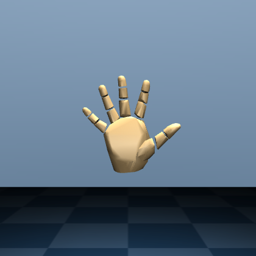

# Board integration

This area owns the only combined ACZ7015 design. It will connect the vision, strain and fusion packaged IP, perform timestamp alignment and expose PS configuration/status plus UDP debugging.

`modules/imu` supplies an independently tested MPU6050 prototype and ImuFrame
contract. It is not yet connected here. Its ARM estimator and PL packet interface
must remain together until a PL estimator is implemented; its standalone PL
timestamp must be aligned to the common integration timebase before fusion.

Module test bitstreams are never nested or linked here. The final Vivado build consumes module IP and emits its own `.bit`, `.hwh` and `.xsa` under `export/bitstream/`.

## First-board bring-up

The current one-IMU/one-strain version deliberately uses the standalone MPU6050
overlay. Loading it replaces the active PL image. From the repository root on the
board, first record the repeatable three-pose strain calibration:

```bash
python3 modules/strain/software/ps/calibrate_strain.py --channels 2
```

Then keep the hand still for the first two seconds and start the SSH-run streamer:

```bash
sudo python3 integration/software/ps/board_stream.py
```

If the MPU6050 overlay is already active, do not reconfigure PL again when
restarting only the streamer:

```bash
sudo python3 integration/software/ps/board_stream.py --reuse-overlay
```

If no calibration file exists, the default `auto` mode enters an explicit preview:
the first sample is the zero point and the absolute change drives bend over a
600-count span. Use `--strain-mode calibrated` to require a completed calibration,
or `--strain-mode preview --preview-span 600` to force the uncalibrated display.

The PS reads `/dev/ttyUSB0`, solves the MPU6050 attitude, maps the calibrated
middle-finger bend, and sends `HAND v2` to `192.168.137.1:47000` at 100 Hz. Camera
position is invalid in this first-board version, so the PC display holds its
default wrist position.

## Current hardware status

- F103 + CH340 alone: 100.00 Hz for 500 frames, no CRC or sequence errors.
- MPU6050 overlay alone: I2C errors 0, dropped samples 0, about 500 pose updates/s.
- Controlled retest: UART passed at 100.00 Hz before the MPU overlay. One overlay
  load left UART healthy and did not increase the 171-message `error -71`
  baseline; a later redundant reload increased the count and left
  `/dev/ttyUSB0` present but unable to return a valid strain frame.
- The onboard RTL8188FTV is soldered to CH334H port 4 and is not a removable
  dongle. H5/H6 are GPIO0 I2C pins; the USB host uses PS MIO/ULPI, so no direct
  FPGA-pin conflict has been found.
- After a full power cycle, one overlay load followed by a `--reuse-overlay`
  restart completed the hardware path: the PC received 486 HAND v2 packets with
  0 dropped and 0 rejected, the USB `error -71` count remained 0, and a final
  standalone UART check received 200 frames at 100.00 Hz with 0 rejected.
- Software `HAND v2` end to end: 240/240 packets received, 0 dropped, 0 rejected,
  and the received pose was rendered by MANO.

The first-board hardware path is accepted with the controlled startup above. The
earlier failure was below the UART decoder, at the Hub/full-speed USB transaction
layer, and appeared during some PL reconfigurations rather than steady-state
computation. Its electrical cause is not yet proven. Do not try to remove the
onboard Wi-Fi device and do not automatically reset the whole Hub; load the
overlay once after a power cycle and use `--reuse-overlay` for streamer restarts.


